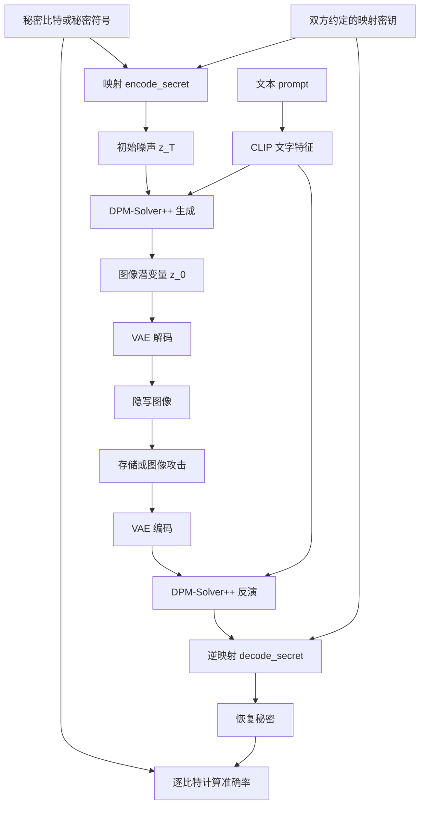

# 项目架构与大作业入门导读

> 本文描述首次分析时的原仓库架构。后续已新增 `grdh_eval/` 本地评测与优化模块、隔离环境和模型准备工具；当前运行方式与协议以 [EVALUATION.md](./EVALUATION.md) 为准。文末首次检查记录不代表后续执行状态。

这份导读针对当前文件夹的实际内容编写，面向刚接触 Python、深度学习与信息隐藏的读者。建议先读第 1—5 部分，建立整体印象，再读第 6—11 部分理解代码与评分，最后按第 14 部分的顺序阅读源码。数学推导可以留到第二遍。

分析依据是本地源码、README、作业 PPT 的两页文字及数学公式、五篇 PDF 的摘要与相关方法章节。还核对了作者的 [GitHub 仓库](https://github.com/HXX5656/mas_GRDH)。本地没有 `.git` 目录，因此无法通过提交历史确定每个文件的修改来源。

分析前，目录共有 75 个文件，包括 44 个 Python 文件、6 个 YAML 配置、5 篇 PDF 和 1 份 PPTX。这里只新增这份导读，没有修改原有算法。检查结果与运行范围见第 15 部分。

## 1. 先理解：这个项目最终做什么

项目研究的是**生成式图像隐写**。它希望把一串二进制秘密信息，例如 `010110…`，变成一张看起来正常的生成图像；接收方再从这张图像中恢复秘密信息。

例如，发送方想传递 `010110…`，并指定画面内容为“一只坐在桌子上的猫”。最终发出去的是猫的图像。接收方处理这张图像，恢复出 `010110…`。

这里有两个完全不同的输入：

| 输入 | 决定什么 | 当前代码中的对应物 |
| --- | --- | --- |
| 秘密消息 | 图像需要携带哪些 0/1 信息 | `random_input` |
| 文本提示词 prompt | 生成什么画面 | `cur_prompt` |

提示词不是秘密消息。“猫”这个词也不是要提取的比特。当前实现中，提取过程还会使用相同提示词。

传统修改式隐写通常从一张已有图像出发，修改像素或变换系数来藏消息。这个项目从消息出发，通过生成模型合成图像。**它把秘密安排在生成过程的起点——初始噪声中。**

因此，整个项目最值得记住的一句话是：

> 将秘密消息可逆地映射为噪声，用 Stable Diffusion 把噪声变成图像，再通过图像编码、扩散反演和逆映射恢复秘密。

## 2. 你现在拿到的材料，分别是什么

这份仓库是论文 **Establishing Robust Generative Image Steganography via Popular Stable Diffusion** 的官方实现。README 的引用信息是 IEEE TIFS，2024 年，DOI 为 `10.1109/TIFS.2024.3444311`。作者说明，它基于 Stability AI 的 Stable Diffusion 代码，沿用预训练模型架构和权重。

“Baseline”可以理解为：老师给出的一个已有起点。先复现它的行为和指标，再在相同条件下比较改进，才能说明改进是否有效。

当前文件夹中有三类材料：

| 材料 | 用途 |
| --- | --- |
| 原仓库的源码、配置、prompt、README、`sd.png` | 提供 baseline 的实现与说明 |
| 你添加的 `paper/` | 阅读资料；程序不会自动读取或使用这些论文 |
| `信息隐藏技术2026大作业.pptx` | 定义你最终需要实现和评测的任务 |

**`paper/` 中的五篇论文都不是当前仓库对应的那篇原论文。** 论文主题相近，并不意味着实现可以直接互换。第 13 部分会逐篇说明关系。

这个项目的工作方式是 Python 命令行实验：没有网页前端、后端服务或数据库。它的“架构”主要指脚本、模型组件、配置、数据和评价流程怎样配合。

## 3. 入门必须分清的几个词

| 词语 | 在这个项目里如何理解 |
| --- | --- |
| Python | 编写实验程序的语言，`.py` 是源码文件 |
| PyTorch / `torch` | 执行张量运算和神经网络计算的框架 |
| 张量 tensor | 多维数组；图像、噪声和文字特征都用数组表示 |
| 模型架构 | 神经网络由哪些层组成、数据怎样流动 |
| 权重 weights / checkpoint | 网络已经学到的大量数值，通常保存为 `.ckpt` 等文件 |
| 配置 config | 指定使用哪个类、各模块参数和模型路径的说明文件 |
| 推理 inference | 使用已经训练好的模型进行计算 |
| 训练 training | 用数据和损失函数更新模型权重 |
| 潜空间 latent space | 模型使用的内部表示；本项目中每张图像对应较小的特征数组 |
| 采样 sampling | 在这里通常指从噪声逐步生成图像潜变量的过程 |
| 反演 inversion | 从图像潜变量近似恢复生成时初始噪声的过程 |
| 鲁棒性 robustness | 图像被压缩、加噪、滤波后，消息还能恢复多少 |

注意：“从噪声生成图像”的采样，与“随机生成一串数”的采样，是两个不同层次的用法。

代码、配置、权重也需要分开理解。例如：

- `.py` 定义如何搭建并计算神经网络。
- `.yaml` 选择并组合这些网络。
- `.ckpt` 保存训练得到的权重数值。

只下载源码，并不等于已经拿到了模型。当前项目目录没有 SD checkpoint，也没有本地 CLIP 模型目录。

## 4. 整个文件夹的地图

```text
mas_GRDH-main/
├── README.md                  项目说明、原论文、权重链接、测试方式
├── .gitignore                 Git 忽略规则，不参与模型计算
├── sd.png                     原方法的整体流程图
├── 信息隐藏技术2026大作业.pptx  你的任务与评分规则
├── scripts/                   隐写实验的主要代码，优先阅读
│   ├── txt2img.py             主入口：生成、攻击、提取、统计
│   ├── mapping_module.py      秘密消息与初始噪声之间的映射
│   ├── robust_eval.py         图像攻击与存储测试
│   ├── utils.py               图像转换、尺寸处理、格雷码等工具
│   └── test_prompts.txt       示例提示词，159 条
├── configs/stable-diffusion/   模型组装配置
│   ├── ldm.yaml               README 指定的 SD 1.5 主线配置
│   └── 另外五个 YAML          SD 2、修复、深度引导、超分辨率等配置
├── ldm/                       潜扩散模型基础实现
│   ├── util.py                根据配置动态创建对象等通用工具
│   ├── models/                完整模型及采样器
│   │   ├── autoencoder.py     VAE，连接图像与潜变量
│   │   └── diffusion/
│   │       ├── ddpm.py        扩散模型组织与统一调用接口
│   │       ├── ddim.py        另一种采样器，主实验未选用
│   │       ├── sampling_util.py
│   │       └── dpm_solver/    主实验使用的生成与反演数值方法
│   ├── modules/               搭建模型的底层积木
│   │   ├── encoders/          文本编码器，如 CLIP
│   │   ├── diffusionmodules/  U-Net、VAE 网络层、扩散工具等
│   │   ├── attention.py      注意力机制，连接图像特征与文字特征
│   │   ├── distributions/    VAE 使用的概率分布
│   │   ├── ema.py            训练时的权重滑动平均支持
│   │   ├── image_degradation/复杂图像退化，当前隐写主线未调用
│   │   └── midas/            深度估计，当前隐写主线未调用
│   └── data/                 深度引导任务的数据工具
├── text_prompt_dataset/       多组文字提示词及 Flickr8k 标注资料
└── paper/                     你补充的五篇参考论文
```

目录很多，是因为仓库保留了通用生成模型的多个功能分支。**零基础不需要先读完 `ldm/`。首先读懂 `scripts/` 四个 Python 文件，就能抓住这项实验的主要行为。**

`__init__.py` 通常用于组织 Python 包，不是额外的算法。多数这样的文件为空。两个非空例子是 `dpm_solver/__init__.py`，它导出采样器类，以及 `image_degradation/__init__.py`，它导入退化函数。

## 5. 看懂 Stable Diffusion 的三个主要组件

这里可以把 Stable Diffusion 分成三个职责清楚的部分：

| 组件 | 做什么 | 对应代码 |
| --- | --- | --- |
| CLIP 文本编码器 | 把提示词转换为网络能处理的文字特征 | `ldm/modules/encoders/modules.py` 的 `FrozenCLIPEmbedder` |
| U-Net | 根据当前潜变量、时间和文字特征预测去噪所需的信息 | `ldm/modules/diffusionmodules/openaimodel.py` 的 `UNetModel` |
| VAE | 在 RGB 图像与图像潜变量之间转换 | `ldm/models/autoencoder.py` 的 `AutoencoderKL` |

另外还有**采样器**：它反复调用 U-Net，并按数值更新规则推进生成过程。本实验选择 `DPMSolverSampler`，底层默认使用 DPM-Solver++。

要特别分清三个对象：

1. **初始噪声 `z_T`**：生成过程的起点，本项目在这里编码秘密。
2. **图像潜变量 `z_0`**：扩散采样结束后的内部图像表示。
3. **RGB 图像 `x`**：VAE 解码后的可见图像。

`z_T` 和 `z_0` 的形状可以相同，但含义不同。它们也都不是最终 RGB 图像。

默认一张图像的数组形状如下。维度按“批大小、通道数、高、宽”排列：

| 对象 | 默认形状 | 含义 |
| --- | --- | --- |
| 秘密符号 `random_input` | `[1, 4, 64, 64]` | 共 16,384 个秘密符号位置 |
| 初始噪声 `init_latent` | `[1, 4, 64, 64]` | 映射后的浮点数组 |
| 文字条件 `c` | `[1, 77, 768]` | 该 CLIP 配置的文字特征；77 是填充/截断后的 token 长度 |
| 图像潜变量 `z_0` | `[1, 4, 64, 64]` | 采样器的生成结果 |
| RGB 图像 `x0_samples` | `[1, 3, 512, 512]` | 三个通道对应 RGB |
| 恢复噪声 `z_enc` | `[1, 4, 64, 64]` | 反演结果 |

潜变量的 4 个通道是网络内部特征，不是 RGBA 四通道图片。`--f 8` 对应空间尺寸缩小 8 倍，即 `512 / 8 = 64`。配置中的 `scale_factor: 0.18215` 是潜变量数值缩放，和空间缩小 8 倍是两回事。

## 6. 完整数据流：一条消息怎样走过项目



用 `scripts/txt2img.py` 中的实际变量，按执行顺序读一遍：

| 顺序 | 程序做什么 | 关键调用或变量 |
| --- | --- | --- |
| 1 | 读取命令行参数，选择攻击与映射方法 | `argparse`、`getattr(...)` |
| 2 | 读取 YAML 并创建模型，再载入权重 | `OmegaConf.load`、`load_model_from_config` |
| 3 | 从指定文本文件逐行读 prompt | `opt.test_prompts`、`prompts` |
| 4 | 将当前 prompt 转成文字特征 | `get_learned_conditioning` 得到 `c` 和空提示词条件 `uc` |
| 5 | 随机生成秘密符号和映射密钥 | `random_input`、`seed_kernel`、`seed_shuffle` |
| 6 | 将秘密符号变成初始噪声 | `mapping_func.encode_secret` → `init_latent` |
| 7 | 从初始噪声生成图像潜变量 | 第一次 `sampler.sample` → `z_0` |
| 8 | 将潜变量解码成可见图像 | `model.decode_first_stage(z_0)` |
| 9 | 模拟 PNG、JPEG、加噪或滤波等操作 | `attack_func(...)` |
| 10 | 将接收图像编码回潜空间 | `encode_first_stage`、`get_first_stage_encoding` → `init_latent_hat` |
| 11 | 从图像潜变量反演回初始噪声 | 第二次 `sampler.sample`，`DPMencode=True` → `z_enc` |
| 12 | 对恢复噪声做逆映射，再逐比特统计 | `decode_secret`、`cal_acc`、`acc_records` |

当前脚本把发送方、攻击信道、接收方和评分程序写在同一个循环里。因此，接收方可以直接使用内存中的原 prompt 和密钥。实际独立提取时，不能再依赖这段循环仍在运行。

这里有两种“编码”和两种“解码”：

- `encode_secret` / `decode_secret`：消息与噪声之间转换。
- VAE 的 `encode_first_stage` / `decode_first_stage`：图像与图像潜变量之间转换。

扩散的生成与反演位于它们中间。读代码时，先判断一个函数的输入、输出属于哪一层，就不容易混淆。

## 7. 隐写算法的核心：`mapping_module.py`

这个文件统一定义了两个接口：

```python
encode_secret(secret_message, ...)  # 秘密符号 -> 初始噪声
decode_secret(pred_noise, ...)      # 恢复噪声 -> 恢复符号
```

不同的映射方法，都接入相同的生成与提取流程。这是最适合首先理解、之后再做对照实验的模块。

### 7.1 `simple_mapping`：先用正负号理解

仅支持每个潜变量位置 1 bit。它先取高斯随机数的绝对值，再根据秘密比特设置符号：

- 比特 0 → 负数。
- 比特 1 → 正数。
- 提取时检查恢复噪声的符号。

例如 `[-0.7, +1.2, -0.1]` 对应 `010`。如果第三个数受扰动变成 `+0.02`，最后一位就会提取错误。

这说明了鲁棒性的一个基本问题：**编码值离判决边界越近，越容易因扰动跨过边界。**

### 7.2 `tmm_mapping`：把高斯分布分成若干区间

若每个潜变量位置存 `b` bit，就有 `L = 2**b` 种符号。该方法将高斯分布划分为 L 个等概率区间，根据秘密符号选择区间，再在区间内采样。

代码使用 `norm.ppf` 和 `norm.cdf`：可以先把它们理解为“概率位置与高斯数值之间的转换器”。提取时，看恢复值落入哪个区间。

文件注释标注了该对照方法的论文链接。名称中的 TMM 是作者用于区分方法来源的标识，不是另一个大型模型。

### 7.3 `ours_mapping`：当前默认方法

先理解 1 bit 的情况：

1. 将秘密消息中的 `0/1` 转成 `-1/+1`。
2. 根据 `seed_kernel` 生成随机矩阵，并通过 QR 分解得到正交矩阵 Q。
3. 对每个秘密矩阵执行双边变换 `Q @ S @ Q.T`。
4. 根据 `seed_shuffle` 打乱全部元素的位置。
5. 把结果作为扩散模型的初始噪声。

接收方先撤销打乱，再做相反的矩阵变换，最后取整恢复秘密。

“正交矩阵”暂时只需要记住一个性质：`Q.T @ Q = I`。因此，原来的双边变换能够用转置矩阵还原，无需额外训练一个消息提取网络。

对更一般的 b bit：

```text
L = 2**b
μ = (L - 1) / 2
σ = sqrt((L**2 - 1) / 12)
S = (M - μ) / σ

编码：Z = Permute(Q @ S @ Q.T)
提取：M_hat = round(clip((Q.T @ Unpermute(Z_hat) @ Q) * σ + μ))
```

这段公式与代码第 96 行开始的 `ours_mapping` 对应。`@` 表示矩阵乘法，`.T` 表示矩阵转置。实际实现对末两维执行矩阵变换，批次和通道维度参与广播。

这样混合后，在随机且均匀的秘密符号条件下，结果的单元素统计可以接近生成模型期待的高斯噪声。但它并不意味着任意输入消息都会得到严格独立的标准高斯噪声。

还需要把几个概念分开：

- 正交变换和置乱能够撤销，并不会自动纠正所有传输误差。
- 正交变换保持整体误差的二范数，不应理解为“旋转一下就消除了噪声”。
- 置乱和随机种子是这里的映射机制，不能直接当成已经实现了完整加密协议。
- 图示 `sd.png` 写着加密后的秘密消息，但主脚本实际上生成的是随机符号，没有实现消息加密流程。

两把“密钥”在代码中分别是 `seed_kernel` 和 `seed_shuffle`。同一张图像的提取必须使用相同密钥。它们目前每轮随机生成，只存在于内存中，没有随图像保存或按独立协议管理。

### 7.4 更高容量为什么往往更难恢复

当 b 增大，一个位置要区分更多符号。标准化后，相邻符号间隔为 `1/σ`，会逐渐缩小。相同大小的恢复误差，更容易导致符号判断错误。

因此，提高 `bit_num` 增加容量，同时可能降低提取准确率。应该测量这种权衡，不能把“数值能填进去”当成“消息能可靠传出来”。

`tdsc_mapping` 目前整段被注释，没有可用的类实现。文件末尾的演示代码却仍然调用它，因此直接运行 `mapping_module.py` 会遇到未定义名称。主入口默认选择 `ours_mapping`，不会走到该演示分支。

## 8. 深一层：`ldm/` 怎样被组装起来

### 8.1 配置像一张模型组装清单

主线配置是 `configs/stable-diffusion/ldm.yaml`，最上面的关键内容是：

```yaml
model:
  target: ldm.models.diffusion.ddpm.LatentDiffusion
```

这表示从模块 `ldm.models.diffusion.ddpm` 中选择类 `LatentDiffusion`。配置中的 `params` 会作为参数传给这个类。

`ldm/util.py` 的 `instantiate_from_config()` 负责读取这套约定，可以近似理解为：

```python
model = LatentDiffusion(**config.model.params)
```

然后 `LatentDiffusion` 又根据配置创建 U-Net、VAE 和文本编码器。这样，主脚本不需要硬编码所有网络结构。

### 8.2 模型调用关系

```text
txt2img.py
  -> instantiate_from_config(ldm.yaml)
      -> LatentDiffusion
          -> DiffusionWrapper -> UNetModel -> 注意力等网络层
          -> AutoencoderKL -> Encoder / Decoder
          -> FrozenCLIPEmbedder -> tokenizer / CLIPTextModel

txt2img.py
  -> DPMSolverSampler.sample(...)
      -> DPM_Solver 的数值更新
          -> model.apply_model(...)
              -> DiffusionWrapper -> UNetModel
```

`ldm/models/` 主要定义“完整模型如何组织”，`ldm/modules/` 主要提供“组成模型的积木”。两个目录都含有名为 model 的文件，是不同层次的职责。

### 8.3 采样器怎样处理生成与反演

`ldm/models/diffusion/dpm_solver/sampler.py` 把模型接口接到 DPM-Solver++ 上。其 `low_order_sample()` 用较低阶方法启动多步求解，后续交给 `sample_one_step()` 更新。

生成和反演共用同一个 U-Net。`DPMencode=True` 在当前有效路径中会改变时间序列的方向，使求解从接近图像端走向噪声端。它不是在调用一个另行训练的秘密提取器。

配置中的 `timesteps: 1000` 定义模型的扩散时间安排；`dpm_gen_steps: 20` 是本次生成数值求解使用的步数。两者并不要求相同。

这个项目说的“无训练”，是指在当前隐写实验中不额外更新这些预训练模型的权重。它仍然需要运行大模型，也仍然需要 GPU 计算资源。

底层保留了 `training_step()`、损失函数、优化器和 EMA 等训练支持，但 `txt2img.py` 使用 `model.eval()`、`torch.no_grad()`，没有启动训练循环。

### 8.4 VAE 与反演都不是严格无误差逆变换

VAE 的图像编码与解码通常会产生重建误差。当前 `get_first_stage_encoding()` 还使用后验分布的 `.sample()`，包含随机性。扩散反演又是数值近似，之后再叠加存储量化和攻击误差。

因此，即使没有主动 JPEG 或滤波，也不能仅凭映射模块可逆，就认定完整图像链路必然 100% 提取。

`--scale` 控制文字条件引导的强度。代码同时计算空提示词条件与真实提示词条件，并组合预测。可以先理解成：引导参数决定生成过程受文字条件影响的程度。它也可能影响反演，应当一起记录和对照。

## 9. 攻击、图像存储和数据集

### 9.1 `robust_eval.py` 的全部攻击入口

| `attack_layer` | 做什么 | `attack_factor` 的含义 |
| --- | --- | --- |
| `identity` | 直接保留浮点图像，不写入磁盘 | 忽略 |
| `storage` | 保存 PNG 后重新读取 | 忽略 |
| `resize` | 缩放后再恢复原尺寸，使用双线性插值 | 比例，例如 0.5 |
| `jpeg` | 保存为 JPEG 后读取 | 质量因子，例如 70 |
| `mblur` | 中值滤波 | 核尺寸，例如 5 表示 5×5 |
| `gblur` | 高斯模糊 | 核尺寸，例如 3 表示 3×3 |
| `awgn` | 添加高斯噪声并裁剪范围 | 标准差，例如 0.05 |

其中，除 `identity` 与 JPEG 自身的存储流程外，其他分支先通过 `_store()` 写成 PNG，再读取后处理。

**PNG 的无损，是对已经量化为像素整数的数据无损。** 模型产生的浮点图像变成普通 8 bit 图像，本身就发生了量化。因此，`identity` 与 `storage` 是两个有意义的对照条件。

`utils.py` 中的重要函数：

- `tensor_to_pil()`：将模型张量转换为可保存的图像。
- `image_grid()`：把一个或多个图像拼成网格。
- `load_512()`：转换 RGB、处理尺寸，并映射到模型使用的数值范围。
- `gray_code()`：生成格雷码，供多比特准确率计算使用。

### 9.2 高斯噪声的数值范围要统一

当前 `awgn` 在 `[-1, 1]` 范围的图像张量上添加标准差 `factor` 的噪声。如果另一套评测在 `[0, 1]` 范围添加同样数字的标准差，实际扰动强度不同。

例如，本代码中 `factor=0.05` 换算到 `[0,1]` 标度相当于标准差 0.025。PPT 说明了 σ=0.05，但没有说明图像归一化范围；复现老师的评测时，需要按最终评测实现统一这一约定。

### 9.3 `text_prompt_dataset/` 主要是提示词库

这些文本用于控制生成画面，不是当前实验要训练的图像数据集，也不是秘密消息。

| 文件 | 当前条数/行数 | 用途 |
| --- | ---: | --- |
| `scripts/test_prompts.txt` | 159 | README 示例使用的 prompt |
| `chatgpt_dataset.txt` | 654 | 一组句子提示词 |
| `coco_dataset.txt` | 5,000 | 图像描述提示词 |
| `flickr_dataset.txt` | 8,092 | 图像描述提示词 |
| `laion_dataset.txt` | 10,000 | 另一组提示词 |
| `test_dataset.txt` | 160 | 另一组测试提示词 |

不要混淆两个名字相近的测试文件：一个位于 `scripts/`，另一个位于 `text_prompt_dataset/`。

`Flickr8k_text/` 内的文件是原始数据资料：

| 文件 | 内容 |
| --- | --- |
| `readme.txt` | 语料说明与引用信息 |
| `Flickr8k.token.txt` | 原始描述，40,460 行，包含图片 ID 与描述 |
| `Flickr8k.lemma.token.txt` | 词形处理后的描述，40,460 行 |
| `Flickr_8k.trainImages.txt` | 原数据集训练图片名称，6,000 行 |
| `Flickr_8k.devImages.txt` | 验证图片名称，1,000 行 |
| `Flickr_8k.testImages.txt` | 测试图片名称，1,000 行 |
| `ExpertAnnotations.txt` | 人工专家评分，5,822 行 |
| `CrowdFlowerAnnotations.txt` | 众包评分，47,830 行 |
| `__MACOSX/._Flickr8k.lemma.token.txt` | macOS 打包附带的资源元数据，不参与实验 |

当前脚本只读取 `--test_prompts` 指向的文件，并把每一行当作 prompt。它不会自动遍历整个目录，也没有固定抽取 100 条的逻辑。原始带图片 ID 的标注文件不宜不经处理就当成最终提示词文件。

## 10. 大作业要求怎样对应到当前项目

PPT 第 1 页要求：实现生成式图像隐写，使用 Python，测试平台为 Ubuntu、RTX 3090，给定 Python 3.8 与 PyTorch 2.1.0；测试时随机抽取 100 条 prompt。建议使用基于扩散模型的无训练方案，并明确给出了当前仓库作为 baseline。

输入输出要求是：

```text
嵌入：原始 0/1 秘密信息 -> 生成的隐写图像
提取：经过攻击的隐写图像 -> 提取的 0/1 秘密信息
```

这比“在一个循环中随机生成秘密并打印准确率”更完整，需要可以独立调用的嵌入、提取和评价流程。

### 10.1 容量：`bit_num` 不是图像 bpp

PPT 中的容量为：

```text
bpp = 一张图像实际隐藏的秘密比特数 / (图像宽 × 图像高)
```

默认设置有 `4 × 64 × 64 = 16,384` 个潜变量位置，每个位置放 b bit，图像为 `512 × 512`：

```text
消息容量 = 16,384 × b bit
bpp = (4 × 64 × 64 × b) / (512 × 512)
    = b / 16
```

| `bit_num` | 每张图像的原始映射比特数 | 图像 bpp | 仅容量项得分 |
| ---: | ---: | ---: | ---: |
| 1 | 16,384，约 2 KiB | 0.0625 | 18.03 / 30 |
| 2 | 32,768 | 0.125 | 21.00 / 30 |
| 4 | 65,536 | 0.25 | 23.99 / 30 |
| 8 | 131,072 | 0.5 | 26.99 / 30 |
| 16 | 262,144 | 1 | 30 / 30 |

后三行只是容量与公式计算，不表示这些设置已经验证可用或能抵抗攻击。尤其不能为了达到 1 bpp，直接假设把 `bit_num` 改成 16 就完成了任务。

如果未来增加纠错码、长度字段等，需要区分用户有效消息比特与编码后的总比特。例如，码率为 r 的纠错编码，理想情况下用户有效载荷约为原始通道容量的 r 倍，实际还要扣除必要开销。不能把冗余校验位重复计作用户秘密信息。

### 10.2 鲁棒性：作业指定三种攻击

| 作业条件 | 对应现有参数 |
| --- | --- |
| JPEG，Q=70 | `--attack_layer jpeg --attack_factor 70` |
| 高斯噪声，μ=0、σ=0.05 | `--attack_layer awgn --attack_factor 0.05`，同时统一数值范围 |
| 中值滤波，5×5 | `--attack_layer mblur --attack_factor 5` |

准确率按秘密消息的**比特**计算，不是按“整个整数符号是否相等”计算。对于 1 bit，二者相同；对于多 bit，一个符号错了几位，必须按双方约定的比特编码判断。

当前 `cal_acc()` 将符号索引转换为格雷码后，再异或、统计错比特。例如 2 bit 格雷码的顺序是 `00, 01, 11, 10`。如果要输入用户的真实比特串，嵌入端必须把比特组转换为相应的格雷码索引，提取端再转回比特；不能一端按普通二进制编码，另一端只在评分时换成格雷码。

还应区分比特准确率与完整文件恢复。默认一张图像藏 16,384 bit，即使准确率为 99%，平均也约有 164 bit 错误。这足以损坏一段精确数据。作业采用比特准确率评分，但若目标是可靠文件传输，通常还需要纠错与完整性判断。

### 10.3 安全性：本作业用 NIQE 作为评价代理

PPT 将生成图像的平均 NIQE 作为安全性评价，公式里 NIQE 越低得分越高。当前仓库没有 NIQE 的计算代码。

应该按作业定义报告这个指标，同时理解它测的是图像自然度。自然度较好，并不能单独证明图像无法被隐写分析器区分；它也不等于消息内容已加密。这几个概念在报告里应当分清。

按 PPT 的表述，应对测试生成的载密图像统计平均 NIQE，不要随意换成攻击后图像的 NIQE。

### 10.4 评分公式及其含义

从 PPT 的数学公式读取为：

```text
S_capacity = 30 × min(1, ln(1 + 1000 × bpp) / ln(1001))

S_robust   = 50 × (1/3) × Σ max(0, 2 × Acc_i - 1)
            i 分别对应三种指定攻击；Acc_i 取 0 到 1

S_quality  = 20 × min(1, max(0, (8 - mean_NIQE) / 5))

Score = S_capacity + S_robust + S_quality
```

由此可以推导出几个对实验选择很有用的事实：

- 容量得分使用对数增长。默认 0.0625 bpp 已对应约 18.03 分；不必一开始就冲击 1 bpp。
- 对某一种攻击，Acc ≤ 0.5 时，该项有效鲁棒性得分为 0。
- 三种 Acc 都高于 0.5 时，三项平均准确率提高 1 个百分点，总分提高 1 分。
- 平均 NIQE ≤ 3 时质量项满分，≥ 8 时该项为 0，中间线性变化。

例如，假设 bpp=0.0625，三项 Acc 都是 0.90，平均 NIQE=4，那么总分约为 `18.03 + 40 + 16 = 74.03`。这是公式示例，不是这个仓库的实测结果。

如果把 bpp 从 0.0625 提升到 0.125，容量项只增加约 2.98 分；若同时平均 Acc 从 90% 降至 87%，鲁棒性项就减少 3 分。选择方案时，应该比较完整评分，而不是孤立追求容量。

## 11. 当前仓库已有什么，还缺什么

| 作业所需能力 | 当前情况 | 与作业实现的差距 |
| --- | --- | --- |
| 生成式隐写主链路 | 已有 | 可以作为 baseline 的核心 |
| 接收真实的 0/1 消息 | 目前随机生成秘密符号 | 需要比特打包、长度、补齐及多比特编码约定 |
| 独立嵌入接口 | 逻辑在 `main()` 内 | 需要拆出可调用功能 |
| 独立提取接口 | 与生成共用一次运行的内存 | 需要明确模型、prompt、密钥和设置如何双方一致 |
| 三种指定攻击 | 都有对应函数 | 需要统一评测范围、存储和图像数值标度 |
| 固定的 100 条评测 prompt | 没有 | 脚本会读取指定文件的全部行 |
| 比特准确率 | 有 `cal_acc()` | 多比特时要与真实消息编码一致 |
| bpp 统计 | 主入口未实现 | 需要按有效比特与实际图像面积计算 |
| 平均 NIQE | 没有 | 需要增加相同实现与设置下的自然度评价 |
| 最终评分 | 没有 | 需要按 PPT 公式汇总 |
| 完整保存图像和实验记录 | 没有 | 需要逐图保存并关联参数、消息标识、结果 |
| 可复现实验环境 | 没有依赖版本清单 | 需要在老师指定平台验证并记录 |

另外，后续实现前应知道以下实际代码细节：

1. **README 的 `--dpm_steps` 没有控制实际生成步数。** 当前它只被打印。真正传入两次采样的是 `--dpm_gen_steps` 与 `--dpm_inv_steps`。两者默认都是 20，所以照 README 的示例看起来恰好一致。
2. **`--prompt` 当前没有用于生成。** 实际 prompt 来自 `--test_prompts` 指向的文件。后者的默认值是字符串 `chatgpt`，并不会自动变成 `chatgpt_dataset.txt` 的完整路径。
3. **`--tau_a`、`--tau_b` 没有接入主脚本的有效采样调用。** 不应把修改这些参数当成已经改变了实验算法。采样器中还保留了多项历史接口参数。
4. **`--seed` 没有启用统一设种子。** `seed_everything(opt.seed)` 被注释。映射工具中用一个数值重新设种子，也不等于恢复完整的 NumPy RNG 状态；已在随机数发生器消耗过数据后验证了这一点。
5. **默认按单张图像使用更符合现有流程。** prompt 条件并未按任意 `n_samples` 完整复制，部分攻击还把批图像拼成网格后读回，不能直接认为增大批大小就得到了正确的批量评测。
6. **输出图像可能被覆盖。** `tmp_image_name` 在 prompt 循环之前生成，同一次运行多个 prompt 复用该名字。PNG 临时文件对部分攻击还是攻击前图像；`identity` 不保存图像。因此 `outputs/` 不是完整实验结果集。
7. **两种误差日志需要辨别。** `recon-error` 比较初始噪声与反演噪声，含义明确。名为 `encoder-decode error` 的日志却比较 `init_latent` 与 `init_latent_hat`，两者分别属于噪声端和图像潜变量端，不能据此解释为纯 VAE 重建误差。若诊断相应环节，需要比较同层次变量。
8. **默认配置不等于 README 主线。** 参数默认配置指向 SD 2；README 主线要求显式选择 `ldm.yaml` 与匹配的 SD 1.5 权重。SD 2 配置使用的 `FrozenOpenCLIPEmbedder` 还调用了 `open_clip`，但导入语句被注释，这个分支不能直接视作已配置可用。
9. **代码保留了非主线缺件。** 例如配置提到 `ldm.lr_scheduler`，当前目录没有该文件；这处在配置训练优化器时才会用到，并非当前主推理路径的直接阻塞。另一些训练配置也引用了未附带的数据模块。
10. **CPU 回退并不完整。** 虽然脚本检查 CUDA 可用性，权重载入、文字编码器设备和自动混合精度路径仍含 CUDA 假设。作业指定 GPU，可先按该平台建立基线，不要将这段检查理解为 CPU 已适配。
11. **辅助工具也有未覆盖分支。** 例如 `pil_to_tensor()` 的列表分支使用未定义的 `device`。主线图像转换不依赖这一分支，但复用工具时需要留意。
12. **主入口把图像宽高直接设为 512。** `C`、`f` 等参数也需要与预训练模型匹配。当前双边矩阵映射按方形潜变量实现，不能直接把它理解为已经支持任意尺寸或长宽比。

这些是读码发现，不代表已经修复。当前任务是理解架构，原文件保持不变。

## 12. 如何把理解对应到一次 baseline 运行

运行前需要准备与验证：老师指定的 Python/PyTorch 环境、匹配的 SD 1.5 checkpoint、CLIP 模型与 tokenizer 文件，以及主线依赖。当前代码直接涉及 `torch`、`torchvision`、`pytorch_lightning`、`numpy`、`scipy`、`omegaconf`、`transformers`、`einops`、`tqdm`、`Pillow`、`matplotlib`、`opencv-python` 等。

这是一份从 import 得到的依赖提示，不是已验证的版本锁定清单。没有必要因为目录里有其他功能分支，就先安装它们所有依赖。

先把 `ldm.yaml` 的 `cond_stage_config.params.version` 改为可用的 CLIP 模型目录，再在 Ubuntu 的项目根目录进入 `scripts/`。下面仅展示命令结构，路径需要替换：

```bash
cd scripts
python txt2img.py \
  --config ../configs/stable-diffusion/ldm.yaml \
  --ckpt /path/to/v1-5-pruned.ckpt \
  --test_prompts ./test_prompts.txt \
  --mapping_func ours_mapping \
  --n_samples 1 \
  --bit_num 1 \
  --dpm_gen_steps 20 \
  --dpm_inv_steps 20 \
  --dpm_order 2 \
  --scale 5.0 \
  --attack_layer jpeg \
  --attack_factor 70 \
  --outdir ../outputs/jpeg70
```

这条命令会读取该文件的 159 条 prompt，不是作业要求的固定 100 条。理解流程时，可以先另建只含一条 prompt 的文本文件做单样本验证，然后再使用固定评测集。

对于第一轮对照，适合按 `identity`、`storage`、三种指定攻击的顺序评测。这样可以分别观察模型链路、存储量化和攻击引入的误差。比较不同方法时，应复用同一套 prompt、消息和评价约定。

在最终工程中，至少应能区分下面三种职责。下面只是接口示意，仓库目前并没有这些现成函数：

```python
image = embed(bits, prompt, shared_settings)
recovered_bits = extract(attacked_image, prompt, shared_settings)
metrics = evaluate(original_bits, recovered_bits, generated_image)
```

`shared_settings` 表示双方事先一致的模型、密钥和采样设置，具体怎样提供必须遵循作业的最终接口要求。提取函数不能读取原始秘密消息；原始消息只应交给评价程序进行比对。

先补齐可重复、可独立调用的评测流程，再尝试映射、反演步数、后验取均值、纠错等改动，才能知道变化来自哪里。上述方向只是可验证的实验变量，不是已证实能提高成绩的方案。

## 13. `paper/` 的五篇论文，如何阅读和取舍

### 13.1 `Diffusion-Stego.pdf`：与当前主线最接近的参考之一

完整标题是 **Diffusion-Stego: Training-free diffusion generative steganography via message projection**，本地文件是 2025 年 Information Sciences 版本，共 11 页。

它将消息投影到扩散噪声空间，使用预训练扩散模型，无需额外训练；讨论消息提取准确率、图像质量和抗检测能力之间的权衡，也讨论 PNG 整数量化的影响。

适合关注：第 3 节消息投影、不同投影的判决边界、噪声分布与图像质量，以及应用到 Stable Diffusion 时容量如何换算。它的主要 PNG 实验条件，不能直接替代本作业的三种攻击结果；像素空间扩散模型的 bpp 也不能直接照搬到压缩潜空间。

### 13.2 `Generative Steganography Diffusion.pdf`：理解扩散可逆性与 DCT 思路

标题为 **Generative Steganography Diffusion**，本地是 2023 年 arXiv v2 版本，共 9 页。提出 GSD 与 StegoDiffusion，通过扩散生成和反向求解在秘密与图像之间转换，方法中还把秘密安排到潜变量的 DCT 系数。

适合关注：第 3 节整体框架、DCT/IDCT 的作用、图像量化问题，以及为什么需要考虑生成与反演的一致性。

它包含 StegoDiffusion 的训练方案，不能直接归为“拿现有 SD 权重即可完全复现的无训练改法”。论文在其条件下报告的完整恢复，也不能推导为受到 JPEG、噪声和中值滤波后仍必然完整恢复。

### 13.3 CVPR 2022 的 IDEAS：提供不同结构的思路

文件长名为 `Liu_Image_Disentanglement_Autoencoder_for_Steganography_Without_Embedding_CVPR_2022_paper.pdf`，共 10 页。

它把图像表征分成结构和纹理：利用更稳定的结构表达秘密，通过纹理随机性增加生成多样性。包含训练自编码器的过程，技术路线与当前预训练 SD 噪声映射不同。

适合从中理解“把消息放在哪种表征中，可能更稳定”的研究问题，或作为相关工作。若直接迁移其整套模型，会扩大实现与训练工作量。

### 13.4 `Survey.pdf`：建立领域分类

实际标题是 **Image Steganography Approaches and Their Detection Strategies: A Survey**，2024 年 ACM Computing Surveys 版本，共 40 页。

它覆盖图像隐写和隐写分析，适合建立术语、方法类别、检测与评价的知识框架。可以按目录选择阅读传统方法、生成式方法和检测评价部分，无需在动手理解 baseline 前逐页读完。

它最直接帮助的是报告中的问题背景与相关工作，而不是提供一个可以接入 `ours_mapping` 的替换模块。

### 13.5 UNIWARD：传统修改式隐写的重要背景

`Universal distortion function for steganography in an arbitrary domain.pdf`，2014 年，共 13 页，提出 UNIWARD 失真设计。

它关注在已有载体中，怎样根据图像内容分配修改代价，使嵌入更难被统计检测。与当前“秘密→噪声→生成图像”的起点不同。

适合用于对比传统失真最小化隐写与生成式隐写，理解为什么自然度和统计可检测性需要区分。对当前无训练 SD 主线的直接代码帮助相对有限，不必先深入其全部数学推导。

按照当前大作业，可采用这样的阅读顺序：**先补读 baseline 原论文并对照代码，再读 Diffusion-Stego 的方法部分，然后读 GSD；综述按需查阅，IDEAS 和 UNIWARD 用于扩展与对比。** 这个顺序依据的是你当前任务与这些文件的内容，而不是论文优劣排名。

baseline 原论文入口来自 README：[IEEE 页面](https://ieeexplore.ieee.org/abstract/document/10637346)。本次未取得该文全文，因此对本仓库算法的解释以实际源码为准。

## 14. 给零基础的源码阅读顺序

| 阶段 | 阅读什么 | 达到什么程度就可以往下走 |
| --- | --- | --- |
| 1 | PPT、README、`sd.png` | 能区分秘密、prompt、图像、攻击和三类评分指标 |
| 2 | `txt2img.py` 第 226 行之后的执行主线 | 能指出哪段生成消息、哪段生成图像、哪段提取和评分 |
| 3 | `mapping_module.py` 的 `simple_mapping`，再看 `ours_mapping` | 能解释一位秘密如何影响噪声，以及如何取回 |
| 4 | `robust_eval.py`、`utils.py` 的图像转换与格雷码 | 能区分浮点图像、保存后图像、攻击后图像与比特准确率 |
| 5 | `ldm.yaml`、`ldm/util.py` 的动态实例化 | 能从配置找到具体 Python 类 |
| 6 | `sampler.py`、`ddpm.py` 的几个接口 | 能解释生成与反演共用模型，理解图像端与噪声端 |
| 7 | `autoencoder.py`、文本编码器、U-Net 与注意力 | 理解三个主要模型组件的内部组织 |
| 8 | `dpm_solver_plusplus.py` 和论文数学 | 需要研究采样与反演误差时再深入数值公式 |

读 Python 时，可以先识别这些结构：

- `def`：定义一个函数；先看输入和返回值。
- `class`：把数据与相关函数组织成一种对象。
- `import`：使用另一个文件或库提供的功能。
- `if __name__ == '__main__'`：直接运行该文件时才执行的入口。
- `getattr(module, name)`：用字符串名字选择函数或类，本项目用它切换攻击与映射。
- `with torch.no_grad()`：这一段不记录训练用的梯度，主要执行推理。
- `for ... in prompts`：对每条提示词重复完整实验。

不要在第一遍就逐行抠 U-Net 的卷积与注意力计算。先把各步骤的输入、输出和形状写清楚，再进入内部。

可以用下面几道自测判断整体认识是否建立：

1. **为什么没有原始载体图像？** 因为本方法从编码后的噪声直接生成载密图像。
2. **为什么有文字提示词还需要秘密比特？** 文字控制画面内容，秘密比特决定需要传输的信息。
3. **为什么 `bit_num=1` 不是 1 bpp？** 因为它按潜变量位置计数，潜空间面积与通道数不同于图像像素数。
4. **为什么映射无误差还原，不代表整张图像能无误差还原消息？** 因为中间还有 VAE、数值反演、存储量化和攻击。
5. **为什么只保存 PNG 还不够独立提取？** 当前提取还需要一致的模型、prompt、映射密钥及采样设置。
6. **为什么增加容量不一定提高作业分数？** 因为准确率和图像自然度也影响总分，而且容量得分是对数增长。

## 15. 本次验证范围

已完成：

- 遍历分析前的完整文件清单，确认 44 个 Python 文件、6 个模型配置及补充资料的职责。
- 对 44 个 Python 文件进行 AST 语法解析，全部通过。这不等于依赖齐全或所有分支可运行。
- 读取 PPT 两页正文和原生数学公式，提取平台、接口、攻击与评分要求。后续复核已通过本机 PowerPoint 成功导出并查看两页渲染图，保存在 `tmp/ppt_review/`。
- 提取五篇 PDF 文本，查看各自首页渲染，并核对与本任务相关的方法内容；未声称对所有推导进行逐式复核。
- 在现有 Python 3.9 / PyTorch 2.6.0 / NumPy 2.0.1 / SciPy 1.13.1 环境下，验证 `ours_mapping` 在 `[1,4,64,64]` 数据上对 b=1、2、4 的无扰动往返，均完整还原；`simple_mapping` 与 `tmm_mapping` 的 1 bit 无扰动往返也通过。
- 验证映射辅助函数并不总能恢复完整 NumPy 随机状态：先消耗随机数后再调用，前后 RNG 状态不同。

尚未进行完整 SD 生成、反演、三种攻击下的准确率或 NIQE 评测。当前目录缺少模型权重，所检查的本地 Python 环境也未配齐 OmegaConf、Transformers、PyTorch Lightning 等主线依赖。老师指定的 Python 3.8 / PyTorch 2.1.0 / Ubuntu / RTX 3090 环境仍需实际验证。

## 附录：44 个 Python 文件的职责索引

下表按职责覆盖全部 Python 文件。这里的“非主线”表示当前 SD 1.5 隐写流程没有调用其功能；有些模块仍可能在导入阶段加载。

| 文件或文件组 | 职责与阅读优先级 |
| --- | --- |
| `scripts/txt2img.py` | 主实验入口，最高优先级 |
| `scripts/mapping_module.py` | 秘密与噪声的编码、解码和对照方法，最高优先级 |
| `scripts/robust_eval.py` | 存储、JPEG、噪声、模糊与缩放测试，最高优先级 |
| `scripts/utils.py` | 图像格式转换、读取、拼接、格雷码，按调用阅读 |
| `ldm/util.py` | 动态创建模型、通用判断与日志工具，以及额外优化器支持 |
| `ldm/models/autoencoder.py` | VAE 的整体包装，`AutoencoderKL` 是主线组件 |
| `ldm/models/diffusion/ddpm.py` | DDPM、LatentDiffusion 与多种生成任务包装，先只读主线接口 |
| `ldm/models/diffusion/ddim.py` | DDIM 采样器；被 `ddpm.py` 导入，但当前主脚本选 DPM-Solver++ |
| `ldm/models/diffusion/sampling_util.py` | 采样中的维度与阈值辅助函数 |
| `ldm/models/diffusion/dpm_solver/sampler.py` | 主线采样器接口，连接 LDM 与底层求解 |
| `ldm/models/diffusion/dpm_solver/dpm_solver_plusplus.py` | 噪声时间安排、模型包装、数值更新及求解器实现，最后深入 |
| `ldm/modules/encoders/modules.py` | CLIP、OpenCLIP、T5 等编码器包装；主线使用 FrozenCLIPEmbedder |
| `ldm/modules/attention.py` | 图像自注意力、文字交叉注意力、Transformer 组件 |
| `ldm/modules/diffusionmodules/openaimodel.py` | 主 U-Net 与其网络块 |
| `ldm/modules/diffusionmodules/model.py` | VAE 的 Encoder、Decoder 与其他网络组件 |
| `ldm/modules/diffusionmodules/util.py` | 扩散时间安排、张量提取、梯度检查点等工具 |
| `ldm/modules/diffusionmodules/upscaling.py` | 超分辨率用的低分辨率条件处理，非主线 |
| `ldm/modules/distributions/distributions.py` | VAE 后验高斯分布、采样和 KL 等计算 |
| `ldm/modules/ema.py` | 权重指数滑动平均；主线配置 use_ema=False |
| `ldm/modules/image_degradation/bsrgan.py` | 复杂随机退化流程，非当前三种攻击的入口 |
| `ldm/modules/image_degradation/bsrgan_light.py` | 简化退化流程，非主线 |
| `ldm/modules/image_degradation/utils_image.py` | 退化分支的图像工具，非主线；同目录 `utils/test.png` 是测试图 |
| `ldm/modules/midas/api.py` | 深度模型加载、变换与推理包装，非主线 |
| `ldm/modules/midas/utils.py` | 深度图等读写辅助，非主线 |
| `ldm/modules/midas/midas/base_model.py` | MiDaS 模型基类与权重加载，非主线 |
| `ldm/modules/midas/midas/blocks.py` | 深度网络的特征融合等组件，非主线 |
| `ldm/modules/midas/midas/dpt_depth.py` | DPT 深度估计模型，非主线 |
| `ldm/modules/midas/midas/midas_net.py` | MiDaS 深度模型，非主线 |
| `ldm/modules/midas/midas/midas_net_custom.py` | MiDaS 轻量模型，非主线 |
| `ldm/modules/midas/midas/transforms.py` | 深度任务的数据尺寸与归一化变换，非主线 |
| `ldm/modules/midas/midas/vit.py` | 深度网络的视觉 Transformer 支持，非主线 |
| `ldm/data/util.py` | `AddMiDaS` 数据处理，非主线 |
| `ldm/__init__.py`、`ldm/data/__init__.py`、`ldm/models/__init__.py` | 三个空包文件 |
| `ldm/models/diffusion/__init__.py` | 空包文件 |
| `ldm/models/diffusion/dpm_solver/__init__.py` | 导出 `DPMSolverSampler` |
| `ldm/modules/__init__.py`、`ldm/modules/diffusionmodules/__init__.py` | 两个空包文件 |
| `ldm/modules/distributions/__init__.py`、`ldm/modules/encoders/__init__.py` | 两个空包文件 |
| `ldm/modules/image_degradation/__init__.py` | 导入两类退化函数 |
| `ldm/modules/midas/__init__.py`、`ldm/modules/midas/midas/__init__.py` | 两个空包文件 |

六份 YAML 中，`ldm.yaml` 是当前主线；`v2-inference.yaml`、`v2-inference-v.yaml` 是 SD 2 的两种预测参数化配置；`v2-inpainting-inference.yaml` 面向图像修复；`v2-midas-inference.yaml` 面向深度引导生成；`x4-upscaling.yaml` 面向超分辨率。它们需要各自匹配的模型和代码条件，不是六个可随意互换的隐写算法。
